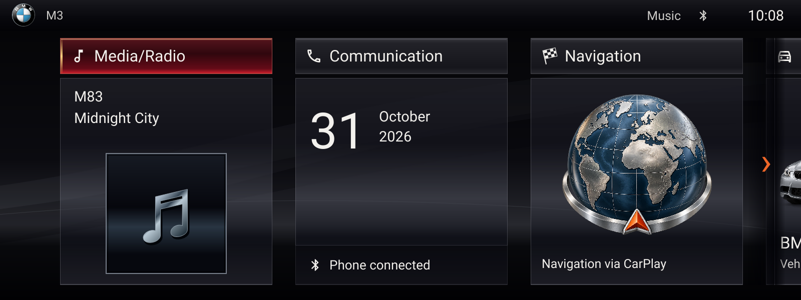
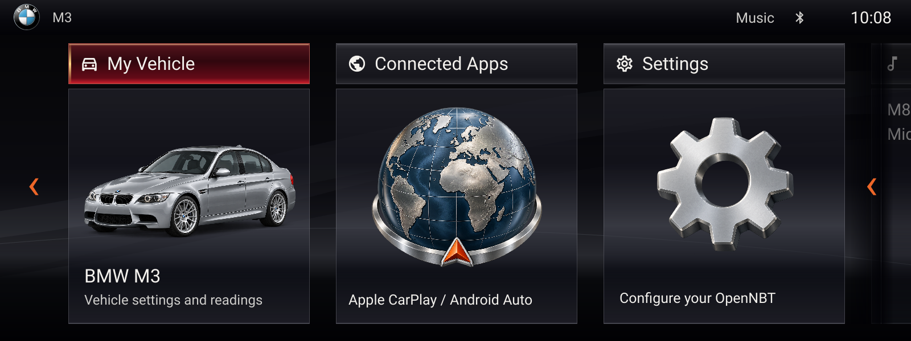
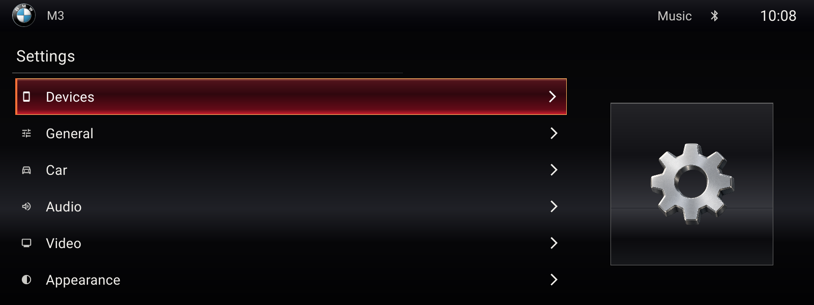
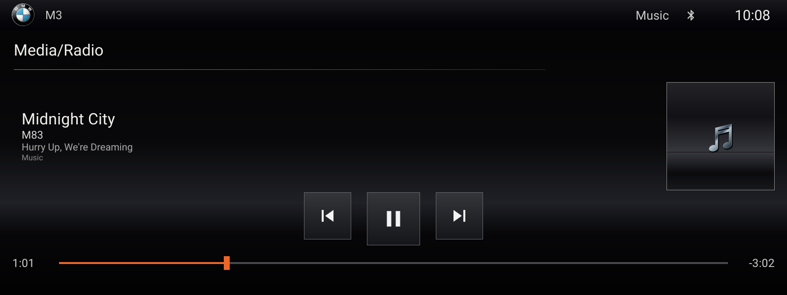

# OpenNBT — E90 M3 interface

OpenNBT is an independent BMW E90-focused fork of native LIVI 10.2, starting
with the M3 and a 1600×600 Pi 5 touch display. Its visual reference is NBT Evo
iDrive 6: dark surfaces, three large horizontal tiles on each of two pages,
glossy burgundy/red focus headers, restrained white typography and split list menus.
The visual pass follows photographed ID6 front-panel references, including
separate header strips, graphite glass materials, a partial next-tile preview,
recessed artwork and a calendar/phone composition.

BMW describes ID6's six live tiles and two-page layout in its
[2017 4 Series introduction](https://www.press.bmwgroup.com/canada/article/attachment/T0267723EN/377702).
OpenNBT uses existing bundled fonts/small icons, original rendered illustrations
and the requested period-correct BMW roundel. [Asset sources and generation
prompts](../native/crates/livi-ui/ui/assets/README.md) document their provenance.
It is not a BMW product and does not include BMW software, maps or ConnectedDrive
services. The fonts and illustrations are close adaptations, not extracted OEM assets.

## Menu mapping

| Tile | Existing destination | Boundary |
| --- | --- | --- |
| Media/Radio | Native media player | Follows configured media availability; radio needs a supported receiver |
| Communication | Mobile devices | Phone management; calls and messaging remain phone features |
| Navigation | Live CarPlay map preview; tap opens phone navigation | Requires the phone's secondary map stream; globe fallback until video is ready |
| My Vehicle | Vehicle settings/readings | Vehicle configuration is not confirmation of physical OEM control |
| Connected Apps | Phone projection | CarPlay/Android Auto provided by the existing projection backend |
| Settings | Native settings | Existing display, sound, connections and system pages |

The first page displays live phone/media state where available. The second page
uses a rendered E90 M3 sedan illustration. Communication shows the local calendar
date; the navigation globe is the fallback for the live map preview. No sample speeds, fuel levels,
service status or vehicle alerts are presented as live data.






## Input and projection

Touch opens tiles; horizontal swipes move between Home pages with a finger-driven
strip and spring snap/rebound. Short drags spring back, fast flicks can change
pages, and the first/last page resist overscrolling without wrapping. The side
arrows and controller navigation use the same spring transition. Recognized
drags cancel tile taps, including vertical drags and swipes starting on the map.
The BMW roundel returns to Home;
on Home it toggles the native navigation menu. The permanent icon rail and large
launcher title have been removed. Existing keyboard/controller focus
navigates all six tiles, switching the visible page with focus. The Home key
opens the launcher when unbound, and top-level native Back returns to it.
Nested settings, editing, configured shortcuts and active phone input keep their
existing ownership. CAN/iDrive hardware integration remains a separate lane.

At 1600×600, media transport controls have 96px touch targets and a 108px
play/pause target, with visible graphite buttons and larger glyphs. The seek bar
accepts scrubbing across a broad touch band, independently of its thin visual
line. Phone/DAB selectors, DAB transport/favorite, settings actions/toggles and
native menu icons also have larger targets. Compact layouts retain separated
controls, and disabled actions remain inactive. Native pointer checks measure
actual hit regions and their corners rather than only inspecting drawn sizes.

The default idle root page opens Home. The root page of an active phone opens
projection; `/projection` explicitly opens it without a phone, and `/home`
explicitly opens OpenNBT. Streaming projection continues to fill the display,
with no OpenNBT header or sidebar overlay and unchanged normalized touch mapping.

Home can display CarPlay's secondary instrument-cluster map stream inside the
Navigation tile. The native tile opens only after the compositor confirms a
correctly sized video buffer for its current placement; paging, menus, disconnect
and resizing restore the fallback. During dragging and spring settling, the
native fallback covers the map until the tiles are stationary and video is ready.
Tapping it opens full-screen phone navigation.
See [map preview implementation and Pi acceptance checks](OPENNBT_MAP_PREVIEW.md).

## Branding and compatibility

Visible application titles, package display names, README and About use OpenNBT.
Internal `livi-*` crate names, `LIVI` executable/package filenames, config paths,
services, protocol names and paired wireless identities are retained so the
working Pi is not migrated implicitly. The GitHub repository is still
`gozmanyoni/LIVI`; this change does not rename the hosted repository.
The phone-facing UI label defaults to OpenNBT for new configurations; existing
saved names and custom labels are preserved.

Upstream copyright and NOTICE attribution remain. Custom theme colors are
retained. ID6 header/list materials use a dark red selection with warm orange
edges. Day mode remains available with legible selected text.

## Verification and deployment

The `opennbt_preview` example renders the actual Slint components using the
existing software renderer, with synthetic media/settings data and no Pi, core,
network or authentication access. Generated screenshots are development fixtures,
not evidence of vehicle integration or hardware performance.

```sh
cargo run --manifest-path native/Cargo.toml -p livi-ui --example opennbt_preview -- home /tmp/opennbt-home.png 1600 600
cargo run --manifest-path native/Cargo.toml -p livi-ui --example opennbt_preview -- home2 /tmp/opennbt-home2.png 1600 600
cargo run --manifest-path native/Cargo.toml -p livi-ui --example opennbt_preview -- settings /tmp/opennbt-settings.png 1600 600
cargo run --manifest-path native/Cargo.toml -p livi-ui --example opennbt_preview -- check
```

`check` dispatches actual pointer events into the Slint components and verifies
all six tile callbacks, paging, disabled-media handling, BMW roundel Home/menu
operation and full-screen normalized
CarPlay touches. It does not establish physical touch or phone interoperability.
It also advances a deterministic native animation clock to verify drag tracking,
flick/distance paging, spring overshoot, edge resistance, interrupted/cancelled
gestures, resizing and map opacity throughout motion. `swipe-demo OUTPUT_DIR`
exports actual native animation frames for visual review.

On the development Mac, the pinned Linux ARM64 environment and dependencies are
retained in a local Docker image/cache. From this repository root:

```sh
docker run --rm --network none --platform linux/arm64 \
  -v "$PWD:/src" \
  -v /private/tmp/livi-core-pi5-build/cargo:/cargo \
  -v /private/tmp/livi-core-pi5-build/rustup:/rustup \
  -v /private/tmp/livi-core-pi5-build/target:/target \
  -e CARGO_HOME=/cargo -e RUSTUP_HOME=/rustup -e CARGO_TARGET_DIR=/target \
  -w /src opennbt-ui-verify:local \
  cargo run --manifest-path native/Cargo.toml -p livi-ui \
  --example opennbt_preview --offline --locked -- check
```

This local image and cache are not distributed by Git. Normal native build
prerequisites apply on a new development machine.

The new launcher and idle-phone labels are currently English. Existing settings
translations and custom color overrides remain available.

Keep experimental UI binaries separate from retained ARM64 image overrides.
Deployment needs a separate build/install, rollback to the retained binaries,
and physical display/touch/CarPlay checks. This source change does not alter the
working Pi or rebuild its private image.
